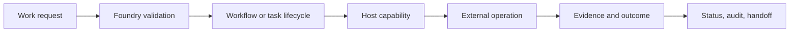

<!-- The Singularity Workshop moniker -->

# TheSingularityWorkshop.Foundry

**Foundry is the host-neutral work coordination domain for The Singularity Workshop Hub.** It defines and validates explicit work, coordinates workflow runs and governed task lifecycles, records outcomes, and exposes authoritative state to its host. Hosts supply environmental capabilities and credentials; GUI may present state but is not the executor.

## 00 — Identity and the domain at a glance

The core path is request → validation → coordinated lifecycle → host-authorized operation → evidence-backed outcome. The diagram is a conceptual overview of the domain, not a claim that every integration is wired into one live service.

> **Implementation status:** `development` contains the version-1 sequential workflow runner and retained in-process run lifecycle; governed work tasks with fenced leases and validated transitions; append-only local task/incident/repair journals; host-scoped capabilities; CODE RED incident and recovery controls; and the lease-gated HeadlessAi turn bridge with its concrete host adapter and manual console composition root. These components are not one distributed service: task journals are single-process local persistence, workflow-run snapshots remain in memory, provider credentials belong to the host, and a live provider invocation has not been verified. The integration proposals in [PR #14](https://github.com/TrentBest/TheSingularityWorkshop.Foundry/pull/14), [PR #15](https://github.com/TrentBest/TheSingularityWorkshop.Foundry/pull/15), and [PR #16](https://github.com/TrentBest/TheSingularityWorkshop.Foundry/pull/16) remain separate draft branches; their callback ingress, report-consumer, and DNS-pinned transport changes are not represented as part of `development`. See the [theory learning path](docs/THEORY/README.md), [roadmap](docs/ROADMAP.md), and [documentation index](DOCUMENTATION_INDEX.md) for the domain map and evidence boundaries. No package publication or deployment is part of this work.

## 01 — What Foundry is

Foundry is the coordinating authority for explicit work. It owns the semantics of workflow definitions, validation, execution lifecycle, task coordination, bounded recovery, and structured outcomes. It does not own the host's credentials, external systems, or presentation layer. Workflow definitions are data; hosts explicitly register the capabilities that definitions may invoke.

## 02 — Why explicit coordination matters

Workflow meaning should not be buried in a desktop window, browser component, or CI YAML. A host-neutral execution boundary lets work be inspected and tested independently of GUI or a particular platform. Separating intent, lifecycle, capability, and evidence makes malformed requests, stale workers, untrusted model proposals, and mismatched CI results rejectable rather than implicit.

## 03 — How ownership boundaries work

- **Foundry executes:** validates workflows; accepts and starts runs; coordinates lifecycle and cancellation; exposes status snapshots and structured outcomes.
- **The / Architect owns the Hub experience:** decides what work to request and when the Hub should present itself.
- **GUI presents:** renders the Hub workbench and maps explicit user intents to supported commands. It does not own execution state or the authoritative loop.
- **FSM_COS composes:** resolves MicroBundles and returns a `RuntimeAssembly`. Composition is not workflow execution.
- **Hosts provide capabilities:** AnyApp (WPF), WebApp (web), The (workshop/Hub surface), WebPage, and headless/CI hosts adapt their environment and register permitted handlers. The shared-runtime requirement applies to all four application hosts; listing a host here describes the intended ownership boundary, not proof that its adapter is already implemented.
- **FSM_API supplies FSM mechanics** where a concrete integration consumes it. Foundry does not reimplement FSM_API.

Foundry deliberately does not force workflow steps, WebPage process-group ticks, and FSM_COS `RuntimeAssembly` into one abstraction. They remain distinct until a source-backed, tested integration demonstrates the correct seam.

## 04 — See it in a minute

Start with the [version-1 workflow definition](src/Foundry.Workflow/WorkflowDefinition.cs), [sequential runner](src/Foundry.Workflow/WorkflowRunner.cs), and [retained execution coordinator](src/Foundry.Workflow/WorkflowExecutionCoordinator.cs).

A host can:
1. Register allowed operations in `WorkflowHandlerRegistry`.
2. Submit a typed workflow definition and receive an `Accepted` run snapshot.
3. Start that run once and observe its lifecycle through `GetSnapshot`.
4. Request cancellation through `Cancel`.
5. Read the terminal `WorkflowResult` and per-step outcomes; an optional workflow timeout reports `TimedOut` separately from caller-requested `Cancelled`.

The first version executes named handlers sequentially. It validates the complete definition before invoking any handler, stops after failure, distinguishes cancellation from failure and timeout, and records remaining steps as skipped. Cancellation and timeout are cooperative: a handler that ignores its token cannot be forcibly stopped. The coordinator retains snapshots only in memory.

The separate [FSM_API probe](src/Foundry.FsmApiProbe/Program.cs) and [fox/sheepdog scenario](src/Foundry.FoxSheepdog/Program.cs) remain deterministic state-execution demonstrations. They exercise real FSM_API behavior and generate reproducible evidence; they are not automatically treated as Hub workflows.

## 05 — Choose your next step

- [Workflow semantics](docs/WORKFLOW_SEMANTICS.md) — validation, execution, lifecycle, cancellation, and outcome rules.
- [Governed work task lifecycle](docs/WORK_TASK_LIFECYCLE.md) — versioned task envelope, fenced leases, validated transitions, audit events, and current limitations.
- [CiAi artifact callback contract](docs/CIAI_ARTIFACT_CALLBACK_CONTRACT.md) — versioned HTTPS ready-notice receiver, authenticated sender, immutable artifact pull, durable receipts, and retry semantics.
- [Foundry–HeadlessAi turn bridge](docs/HEADLESSAI_TURN_BRIDGE.md) — lease-gated model invocation, durable duplicate suppression, host adapter mapping, and current integration limits.
- [Concrete HeadlessAi host adapter](docs/HEADLESSAI_HOST_ADAPTER.md) — source-pinned in-process adapter, immutable request mapping, normalized result mapping, credential boundaries, and a manual real-provider smoke runner.
- [Foundry theory learning path](docs/THEORY/README.md) — modular textbook chapters explaining the domain, implementation, evidence, and limits.
- [Domain and ownership](docs/DOMAIN.md) — what Foundry owns and what it does not.
- [Architecture](docs/ARCHITECTURE.md) — subsystem boundaries and integration decisions.
- [Contract inspection ledger](docs/CONTRACT_INSPECTION.md) — source-backed findings and unresolved questions.
- [Roadmap and readiness](docs/ROADMAP.md) — milestones and verification gates.
- [Documentation index](DOCUMENTATION_INDEX.md) — documentation entry points.
- [Agent onboarding and contribution policy](AGENTS.md) — ownership boundaries, branch/release guardrails, safety invariants, and documentation/evidence rules.
- [UML documentation](docs/UML/README.md) — source-grounded diagram policy and inventory.

The focused xUnit suite covers ordering, invalid definitions, failure, cancellation, finite/infinite timeouts, cancellation precedence, non-cooperative handlers, CODE RED capability suspension/recovery, and retained run lifecycle. The [Foundry CI workflow](.github/workflows/foundry-fsm-api-probe.yml) runs those tests alongside the FSM_API and fox/sheepdog evidence checks, and builds the concrete HeadlessAi adapter against a pinned source commit.

### Current limits and next steps

Foundry now has two deliberately separate lifecycle boundaries:

- **Workflow execution:** `WorkflowDefinition`, `WorkflowRunner`, and `WorkflowExecutionCoordinator` remain a sequential, in-process execution path. Workflow run snapshots are retained in memory; cancellation and optional timeouts are cooperative; retries, compensation, parallel execution, hard handler termination, and recovery of workflow runs after process loss are not provided.
- **Governed repository work:** `WorkTaskCoordinator` and its persistent adapter record issue/task provenance, bounded attempts, expiring agent leases, audit events, CODE RED incidents, and exact-CI repair decisions. JSONL journals survive a process restart on the same host, but claims and writes are single-process only. They are not a GitHub-backed or distributed store.

The governed-work components do not yet select or claim live GitHub issues, create branches or commits, invoke a live HeadlessAi provider using the implemented source adapter, consume CiAi evidence packets, dispatch authenticated CI reruns, receive remote callbacks, send external CODE RED notifications, or complete a draft-PR handoff. The tested [HeadlessAi turn bridge](docs/HEADLESSAI_TURN_BRIDGE.md) now defines the lease-gated invocation port and durable at-most-once journal, and its concrete source adapter is implemented; the manual host composition root is implemented; credential provisioning and a real provider call remain unverified. The [CiAi artifact callback contract](docs/CIAI_ARTIFACT_CALLBACK_CONTRACT.md) now fixes the intended notice/pull/receipt wire boundary, but its HTTPS receiver and transport adapters are not yet implemented. Host-issued capabilities are an authorization boundary, not a sandbox or a live GitHub adapter.

The next integration gate is to connect the existing task lifecycle to the verified HeadlessAi resumable-turn and CiAi exact-run evidence contracts without introducing another workflow runner. AnyApp currently composes `RuntimeAssembly` through FSM_COS and owns host startup; WebApp still has a transitional `WebAppExperienceRuntime` with a private heartbeat; The is the Hub/workshop surface; and WebPage has legacy process-group contracts. These are not interchangeable inputs: `RuntimeAssembly`, `WorkflowDefinition`, and WebPage `WorkDescriptor` have distinct semantics until a tested adapter proves a mapping. Migrate one host at a time and verify status, cancellation, terminal outcomes, and cleanup before describing it as a Foundry consumer. Keep browser/server and separate-process boundaries explicit. GUI presentation work, generated UML, and optional article workflows follow evidence rather than precede it.

Publication, release, and deployment remain separate actions and require Trent's explicit approval.

---

<!-- THE SINGULARITY WORKSHOP FOOTER -->

