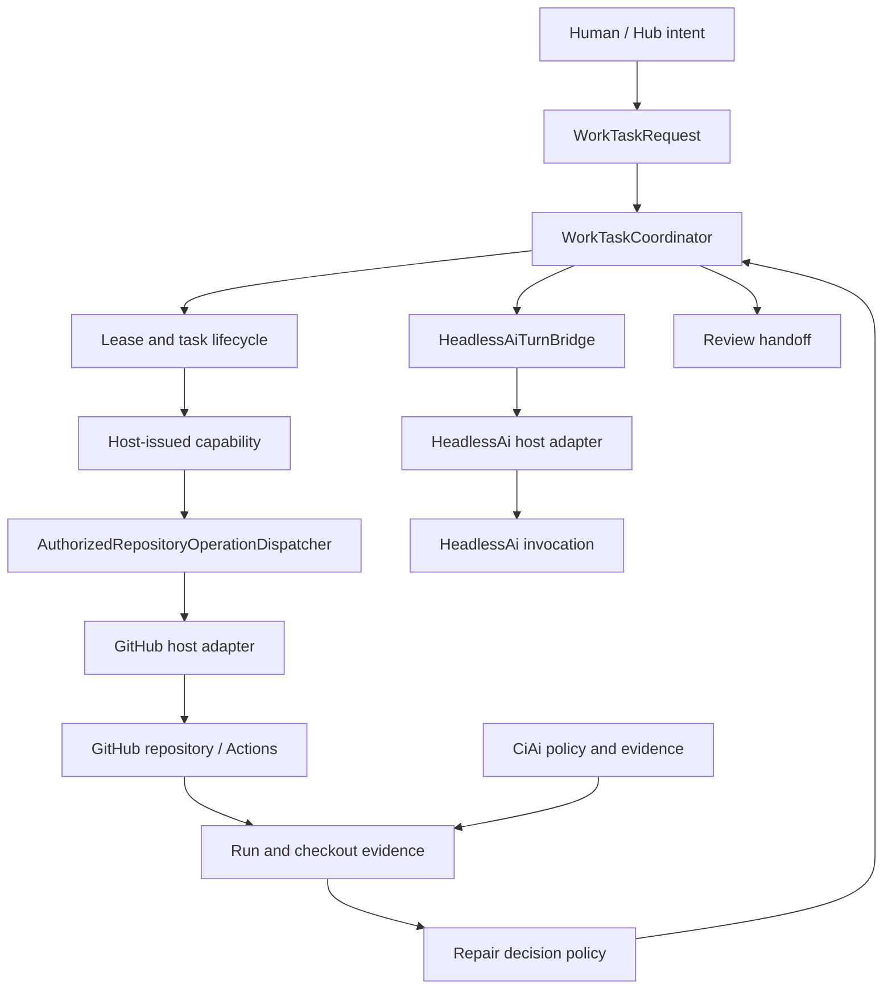

<!-- The Singularity Workshop moniker -->

# Foundry Architecture

**Scope:** Current implementation on `feature/foundry-host-repository-operation-gate`. See the [coverage ledger](../DOCUMENTATION_INDEX.md) for the distinction between this branch, `development`, fake-adapter proof, and live integration.

## 1. System shape

Foundry is the execution and governed-work control plane between human/Hub intent and host-provided capabilities.

The diagram describes ownership and intended data flow, not a claim that the entire path is live. The implemented components and missing joins are listed below.

## 2. Two execution boundaries

### Sequential workflow execution

`WorkflowDefinition` is validated by `WorkflowValidator`, handlers are selected only from the host-owned `WorkflowHandlerRegistry`, and `WorkflowRunner` executes steps sequentially. `WorkflowExecutionCoordinator` owns accepted/running/terminal snapshots, start-once behavior, cooperative cancellation/timeout, and disposal.

This path is intentionally in-process and in-memory. It is suitable for bounded sequential host workflows; it is not the governed task queue, distributed scheduler, or retry engine.

### Governed repository work

`WorkTaskCoordinator` owns task identity, lifecycle, leases, transition history, bounded attempt count, and guarded recovery. `PersistentWorkTaskCoordinator` and JSONL stores provide local durable replay. `WorkTaskCapabilityRegistry` issues host-side scoped grants. `AuthorizedRepositoryOperationDispatcher` revalidates task/lease/capability state immediately before calling an adapter. The repository operation handler is registered into the existing workflow registry when a host chooses to expose that operation.

The two boundaries can compose, but their lifecycles remain distinct: the task is not a workflow run, and a workflow result does not by itself authorize or complete a task.

## 3. Authority flow

1. A trusted host accepts a validated task request and establishes its repository/issue/base-SHA identity.
2. The task coordinator claims the task under a unique, expiring lease.
3. The host grants a short-lived capability for an explicit action set, path set, branch, and candidate SHA.
4. The agent may propose a typed operation. Proposal data contains no credential or capability token.
5. The dispatcher reloads task state and re-demands the capability immediately before external transport.
6. The adapter independently enforces repository allowlists, path containment, branch namespace, exact refs, request bounds, and host credential policy.
7. A durable pending intent is flushed before the side effect. The terminal result is recorded only after provenance validation.
8. The candidate SHA changes only through an explicit commit operation. A changed candidate SHA requires a newly scoped capability.

A capability is authority, not authentication. The host's credential provider authenticates to GitHub; the capability registry constrains what the authenticated host may do for this task.

## 4. GitHub repository adapter

`Foundry.GitHubHost` contains typed REST operations for isolated candidate branch creation, immutable-SHA file reads, staged file writes, explicit commits, and allowlisted Actions dispatch.

- Repository identity and candidate branch namespace are host configured.
- Branch creation is based on the exact task base SHA.
- Reads are bound to the immutable candidate SHA.
- Writes stage immutable blobs and do not move refs.
- Commits use the authorized candidate as parent and advance the candidate ref without force.
- Actions dispatch selects a host-allowlisted workflow and uses trusted `development` as workflow source; candidate branch/SHA are separate inputs.
- Dispatch intent is journaled before the HTTP request. Ambiguous responses are reconciled by request ID; the dispatcher refuses an unsafe duplicate dispatch.
- Run correlation binds workflow path, event, trusted workflow ref/SHA, request ID, run ID, and attempt. GitHub `head_sha` identifies trusted workflow source, not candidate checkout.
- The workflow emits a separate candidate-checkout provenance artifact only after detached checkout verification. Host retrieval and validation of that artifact remain a required integration step.

The adapter tests use fake HTTP handlers and local journals. They prove deterministic request construction, response validation, restart behavior, and refusal paths; they do not prove live GitHub API behavior, production credentials, or installation permissions.

## 5. Agent and CI boundaries

- **HeadlessAi** performs model invocation. Foundry's bridge controls whether a turn may be reserved for a currently leased task, maps immutable requests/results, validates provenance, and persists at-most-once turn state.
- **CiAi** owns CI policy and exact-run verdict/evidence contracts. Foundry can request an allowlisted workflow and correlate/verify the GitHub run, but a dispatch acknowledgment is not a CI verdict.
- **GitHub** owns repository and review state. Foundry's adapter does not make a draft PR or merge decision merely because a run passed.
- **Human/host authorization** remains outside model output. CODE RED recovery requires a trusted signed receipt; merge/release/deploy/publish remain explicit human-controlled actions.

## 6. Durability and recovery

| Store | What it records | Durability boundary |
|---|---|---|
| Workflow coordinator | Run snapshots | Process lifetime only |
| Work-task JSONL store | Task snapshots/events | Local filesystem; cooperating-process lock; not distributed |
| CODE RED incident store | Incident lifecycle | Local JSONL with validated replay |
| Repair-attempt journal | Attempt and exact evidence references | Local JSONL |
| HeadlessAi turn journal | Reservation, completion, indeterminate state | Local JSONL; at-most-once recovery semantics |
| Repository-operation journal | Pending/completed/failed operation audit | Local JSONL; pending requires external reconciliation |
| GitHub dispatch journal | Dispatch intent/ack/correlation/verification | Local JSONL; request-ID reconciliation |
| GitHub | Issues, refs, commits, workflow runs/artifacts, PRs | External system of record |

A local append-only journal is not a distributed transaction. If a process crashes after GitHub performs a side effect but before local completion is recorded, the operation is indeterminate. Recovery must query GitHub and reconcile; never infer failure and blindly repeat the side effect.

## 7. Failure and escalation behavior

- Invalid requests fail before side effects.
- Stale leases and expired/revoked capabilities block privileged operations.
- CODE RED permits only read-only repository access and suspends mutation.
- Recovery is guarded by a signed, single-use, task/incident/sequence-bound approval receipt.
- Exhausted attempts, unavailable or mismatched evidence, ambiguous dispatches, corrupted journals, and uncertain side effects stop or escalate rather than becoming success.
- A model proposal cannot override any of these conditions.
- No merge, release, deployment, branch deletion, or package publication is exposed by the current repository-operation API.

## 8. Explicit non-goals and integration gaps

The current branch does not yet constitute a complete autonomous issue-to-draft-PR system. Remaining integration work includes live issue selection/claim, production GitHub App credentials and re-authentication, distributed stores/leases, candidate artifact retrieval and validation, conversion of exact CI evidence into durable repair-attempt/task state, draft-PR creation/review handoff, and the end-to-end MyVR pilot.

The CiAi callback document describes a protocol contract; it is not proof that the HTTPS ingress/remote transport is deployed. The HeadlessAi source adapter compiling is not proof of a real provider invocation. Fake GitHub/HTTP tests are not live network proof.

## 9. Architectural rules

- Keep `WorkflowRunner` as the only sequential step executor.
- Keep `WorkflowExecutionCoordinator` as workflow-run lifecycle owner.
- Keep `WorkTaskCoordinator` as governed-task lifecycle owner.
- Keep FSM_API as the state-machine mechanics owner wherever consumed; do not add a parallel transition graph.
- Keep FSM_COS composition separate; Foundry does not build or reinterpret `RuntimeAssembly`.
- Keep credentials and host transport outside model-facing contracts.
- Prefer typed allowlisted operations over generic tools.
- Persist intent before external side effects and reconcile indeterminate outcomes.
- Label every claim by branch, test type, exact SHA, and whether evidence is fake-adapter or live.

## Related documents

- [Domain](DOMAIN.md)
- [Workflow semantics](WORKFLOW_SEMANTICS.md)
- [Work-task lifecycle](WORK_TASK_LIFECYCLE.md)
- [Repository operation boundary](REPOSITORY_OPERATION_ADAPTER.md)
- [HeadlessAi turn bridge](HEADLESSAI_TURN_BRIDGE.md)
- [HeadlessAi host adapter](HEADLESSAI_HOST_ADAPTER.md)
- [CiAi callback contract](CIAI_ARTIFACT_CALLBACK_CONTRACT.md)
- [Roadmap](ROADMAP.md)

---

<!-- The Singularity Workshop footer -->

