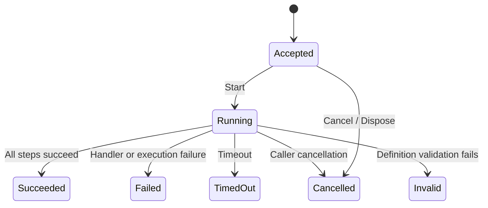

<!-- The Singularity Workshop moniker -->
<p align="center"><a href="https://github.com/TrentBest"></a></p>

# FSM_API Runtime Integration

**Status:** implemented on [draft PR #29](https://github.com/TrentBest/TheSingularityWorkshop.FSM_Foundry/pull/29); exact-head CI verification is pending. This chapter explains the production integration, not merely the standalone FSM_API demonstration.

## 1. Why the dependency belongs in the runtime

FSM_Foundry is named for its operational relationship with FSM_API. The production workflow runtime must use FSM_API for finite-state mechanics instead of maintaining a parallel hand-written lifecycle state machine.

The ownership boundary is deliberate:

- **FSM_API owns:** finite-state definitions, state handles, transition evaluation, processing-group membership, and explicit handle destruction.
- **Foundry owns:** workflow definitions, validation, asynchronous handler execution, task and run identity, cancellation and timeout policy, authorization, audit, result mapping, and host-facing snapshots.
- **WorkflowRunner remains:** the one sequential asynchronous step executor. It is not replaced by FSM_API and no second runner or scheduler is introduced.

FSM_API is the mechanism for workflow-run state transitions. It does not become the owner of Foundry's higher-level workflow semantics.

## 2. Lifecycle model

Each WorkflowExecutionCoordinator creates one FSM_API lifecycle definition in a uniquely named processing group. Each accepted workflow run receives its own FSM_API instance and caller-owned context.

| Foundry lifecycle state | Meaning |
|---|---|
| Accepted | The run has been accepted and has not started. |
| Running | The existing WorkflowRunner is executing the validated sequential workflow. |
| Succeeded | Every workflow step completed successfully. |
| Failed | A handler or unexpected execution operation failed. |
| Cancelled | Caller cancellation or coordinator shutdown ended the run. |
| TimedOut | The workflow timeout requested cooperative cancellation. |
| Invalid | Workflow validation rejected the definition before any handler was invoked. |

The transition graph is intentionally narrow:



Terminal states have no outgoing transitions. Foundry validates that a requested transition is legal, and the FSM_API definition independently evaluates the transition guard before changing the handle's current state.

## 3. How the integration works

### 3.1 Definition and instance ownership

FsmApiWorkflowLifecycle creates a definition containing the lifecycle states and legal edges. It uses a unique processing group and definition name for each coordinator so independent hosts/coordinators cannot collide in FSM_API's static registry.

Submit creates an FSM_API handle for the new run. The handle's CurrentState is the authoritative lifecycle state read by GetSnapshot; Foundry does not maintain a second mutable lifecycle-status field.

### 3.2 Transition requests

A transition request is placed on that run's context. The adapter calls FSM_API.Interaction.Update(processingGroup), allowing FSM_API to evaluate the registered guard and perform the transition. The request is cleared after the update.

This is intentionally not a call to FSMHandle.TransitionTo. Foundry uses its legal-transition policy and FSM_API's defined transition graph together, rather than bypassing the graph with a forced transition.

The processing rate is -1, so the FSM_API group processes every time Foundry explicitly updates it. Foundry does not start a background timer or add a competing scheduler. The group update is a synchronous state-transition operation; asynchronous workflow handlers remain outside FSM callbacks.

### 3.3 Async execution and terminal mapping

WorkflowExecutionCoordinator transitions the run to Running, then invokes the existing WorkflowRunner. The runner validates the complete workflow before invoking handlers and awaits each registered handler in order.

When the runner completes, Foundry applies its existing cancellation-versus-timeout precedence, maps the WorkflowResult to one terminal lifecycle state, and asks FSM_API to perform that transition. The structured workflow result remains a Foundry-owned object; FSM_API's CurrentState supplies the lifecycle state shown in snapshots.

### 3.4 Context and cleanup

The FSM_API lifecycle context implements IStateContext and is created/owned by Foundry. It contains only the run identity and the pending transition request; it does not own the workflow's bounded JSON execution context.

Before removing a handle, Foundry sets the caller-owned context's IsValid to false to suspend further computation, then calls FSM_API.Interaction.DestroyInstance. This distinction matters: IsValid = false is not a destruction command and does not transfer context ownership to FSM_API. The coordinator explicitly destroys its own handles and then its own definition during disposal.

Because FSM_API exposes a static registry, the adapter serializes registry operations through a process-wide lock. Each coordinator still owns a separate group and definition. The implementation does not remove a shared processing group or destroy another coordinator's instances.

## 4. Development dependency: source, not published package

The production workflow project and both FSM_API demonstration projects use a direct ProjectReference to the FSM_API source project:

```xml
<ProjectReference Include="../../fsm-api/FSM_API/FSM_API.csproj" />
```

The Foundry CI workflow checks out FSM_API from its development branch at the exact commit:

4db572f5e0e74df028b01ee22fb393e2bd203eb6

For a local build, clone the matching FSM_API source into the Foundry repository root as fsm-api:

```bash
git clone https://github.com/TrentBest/FSM_API.git fsm-api
git -C fsm-api checkout 4db572f5e0e74df028b01ee22fb393e2bd203eb6
dotnet test tests/Foundry.Workflow.Tests/Foundry.Workflow.Tests.csproj
```

The local fsm-api checkout is ignored by Foundry's .gitignore; it is a source dependency checkout, not a nested copy committed into Foundry. Update the pinned commit deliberately when adopting a newer FSM_API development revision. Do not substitute a published NuGet package during active development. Package publication remains a separate, explicitly authorized release-gate action.

## 5. Verification and limits

The integration tests exercise the real FSM_API-backed coordinator lifecycle, including independent coordinators, successful completion, cancellation, timeout, invalid workflow mapping, and cleanup. The existing FSM_API probe and Fox/Sheepdog scenario remain additional integration demonstrations; they are not substitutes for the production lifecycle tests.

What this integration does not claim:

- It does not move asynchronous workflow handlers into FSM_API callbacks.
- It does not make the in-memory workflow coordinator durable across process loss.
- It does not provide a distributed scheduler or cross-process FSM_API registry.
- It does not make task journals, GitHub operations, CiAi evidence, or HeadlessAi exchanges FSM_API state machines by implication. Those domain boundaries require their own explicit mappings and tests.
- It does not authorize merge, release, deployment, branch deletion, or NuGet publication.

The next domain integration should apply the same rule: use FSM_API for actual state mechanics, retain Foundry ownership of higher-level operational meaning, and prove every adapter with deterministic tests before describing it as complete.

## Source and test map

- [FSM_API lifecycle adapter](../src/Foundry.Workflow/FsmApiWorkflowLifecycle.cs)
- [Workflow execution coordinator](../src/Foundry.Workflow/WorkflowExecutionCoordinator.cs)
- [Sequential workflow runner](../src/Foundry.Workflow/WorkflowRunner.cs)
- [FSM_API lifecycle integration tests](../tests/Foundry.Workflow.Tests/FsmApiWorkflowLifecycleTests.cs)
- [Pinned FSM_API CI checkout](../.github/workflows/foundry-fsm-api-probe.yml)
- [Workflow semantics](WORKFLOW_SEMANTICS.md)

---

<!-- THE SINGULARITY WORKSHOP FOOTER -->
<p align="center"></p>
