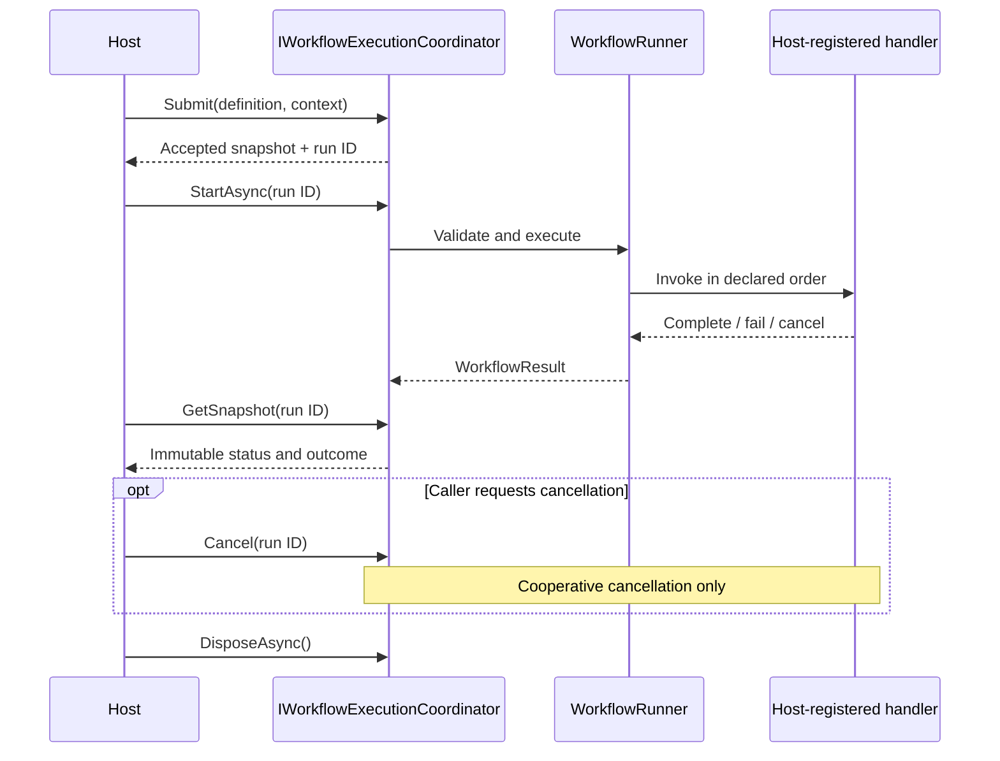

<!-- The Singularity Workshop moniker -->

# Hub Execution Ownership and Host Contract

**Status:** source-backed contract note for Foundry `development` at `8bd3487a96af2cd7d667f62c4566a499bafe30dc`. The host-facing workflow contract described here is implemented and tested. Full Hub/RuntimeAssembly scheduling integration is not implemented.

## 01 — Ownership boundaries

| Concern | Owner | Source-backed responsibility |
|---|---|---|
| MicroBundle discovery, installation, arbitration, effective composition | FSM_COS / MicroBundleDomain | FSM_COS owns composition and returns `RuntimeAssembly`; Foundry must not re-resolve or recompose bundles |
| Workflow definition, validation, sequential execution, run lifecycle and result | Foundry | `WorkflowDefinition`, `WorkflowValidator`, `WorkflowRunner`, `WorkflowExecutionCoordinator` |
| Hub bundle registry, bounded arbitration, warehouse identity mapping, routing, process-group registration/state | WebPage's Hub domain (legacy behavior to be reconciled) | `SingularityHub` implements `ISingularityHub`; it is not the Foundry workflow runner |
| Host capabilities, startup/shutdown, credentials, provider bindings | AnyApp, WebApp, The, WebPage, headless host | Hosts compose Foundry and supply allowlisted handlers/capabilities |
| Semantic workbench and manifestation | GUI | GUI observes Foundry snapshots and emits explicit intents; it is not execution authority |

The boundaries are related but are not interchangeable. A `RuntimeAssembly` is a composed runtime result, a `WorkflowDefinition` is a versioned data-only sequence of named handlers, and WebPage's `WorkDescriptor` is a compact process-group work descriptor. No tested mapping currently turns one into another.

## 02 — Existing Foundry host-facing contract

The existing `WorkflowExecutionCoordinator` already provides the initial command/query surface:

- `Submit(definition[, context])` accepts a run and returns an `Accepted` snapshot without executing handlers.
- `StartAsync(runId[, timeout])` starts an accepted run exactly once and returns its terminal `WorkflowResult`.
- `GetSnapshot(runId)` observes the current immutable lifecycle snapshot.
- `Cancel(runId)` requests cancellation before or during execution.
- `DisposeAsync()` cancels outstanding work and waits for cooperative completion.

The new `IWorkflowExecutionCoordinator` is a narrow host-facing interface over that existing behavior. It deliberately adds no queue, scheduler, transport, persistence, retry, or authorization semantics. A host may register the concrete coordinator behind this interface in its composition root; a GUI or other client should depend on the interface through a host adapter rather than construct the handler registry itself.

### Lifecycle contract

## 03 — Existing Hub/process-group behavior is distinct

WebPage `SingularityHub.Abstractions/HubContracts.cs` declares `ISingularityHub`, `IArbitrator`, `IProcessGroupHost`, `WorkDescriptor`, `CompletionToken`, and `IExecutionProvider`.

On WebPage `development`, `SingularityHub/SingularityHub.cs`:

- registers, loads, and arbitrates MicroBundles (maximum ten rounds);
- maps warehouse identities and exposes routing/configuration/audit;
- registers, activates, and completes process-group identities;
- dispatches `Update()`, `UpdateNestedProcessGroups()`, and `UpdateProcessGroup()` through an injected `Action<string>` update sink (defaulting to `FSM_API.Interaction.Update`).

The declared `IExecutionProvider.Execute(WorkDescriptor)` is not wired into this `SingularityHub` update path. The process-group update callback is not equivalent to Foundry's named workflow handler invocation. These legacy responsibilities must be classified and migrated only where a concrete semantic adapter is tested.

## 04 — Current limitations and integration gates

- Foundry's coordinator is in-process and in-memory; it is not a durable queue or remote transport.
- A host must supply the `WorkflowHandlerRegistry`; the coordinator does not discover providers or execute arbitrary manifest code.
- Workflow steps execute sequentially in declaration order. There is no general dependency-graph scheduler or RuntimeAssembly scheduler.
- Cancellation and timeout are cooperative; a handler that ignores its token can delay completion and disposal.
- FSM_COS RuntimeAssembly handoff has no implemented Foundry adapter.
- GUI has no authority to mutate run state; its host adapter must map user intents to the command/query contract.
- WebPage process-group semantics remain a separate legacy/domain contract until the scheduling-intent and composition contracts are understood.

## 05 — Implementation map

- [Workflow coordinator interface](../src/Foundry.Workflow/IWorkflowExecutionCoordinator.cs)
- [Workflow coordinator implementation](../src/Foundry.Workflow/WorkflowExecutionCoordinator.cs)
- [Workflow runner](../src/Foundry.Workflow/WorkflowRunner.cs)
- [Workflow definition](../src/Foundry.Workflow/WorkflowDefinition.cs)
- [Workflow lifecycle tests](../tests/Foundry.Workflow.Tests/WorkflowExecutionCoordinatorTests.cs)
- [WebPage Hub contracts](https://github.com/TrentBest/WebPage/blob/development/SingularityHub.Abstractions/HubContracts.cs)
- [WebPage Hub implementation](https://github.com/TrentBest/WebPage/blob/development/SingularityHub/SingularityHub.cs)
- [Foundry Hub ownership issue](https://github.com/TrentBest/TheSingularityWorkshop.Foundry/issues/1)
- [Scheduling-intent dependency](https://github.com/TrentBest/TheSingularityWorkshop.Foundry/issues/2)

## 06 — Next integration sequence

1. GUI consumes the interface through a host-owned adapter and tests presentation/intent mapping.
2. Foundry and FSM_COS/MicroBundleDomain define the exact scheduling declaration and RuntimeAssembly handoff, including provenance and same-frame dependency semantics.
3. Foundry adds scheduling only for declared capabilities and provider contracts that survive composition; it does not infer ontology or create a second arbitrator.
4. WebPage/AnyApp/WebApp/The migrate only the lifecycle responsibilities covered by the tested Foundry contract, retaining host and experience behavior at their proper boundaries.

---

<!-- THE SINGULARITY WORKSHOP FOOTER -->

