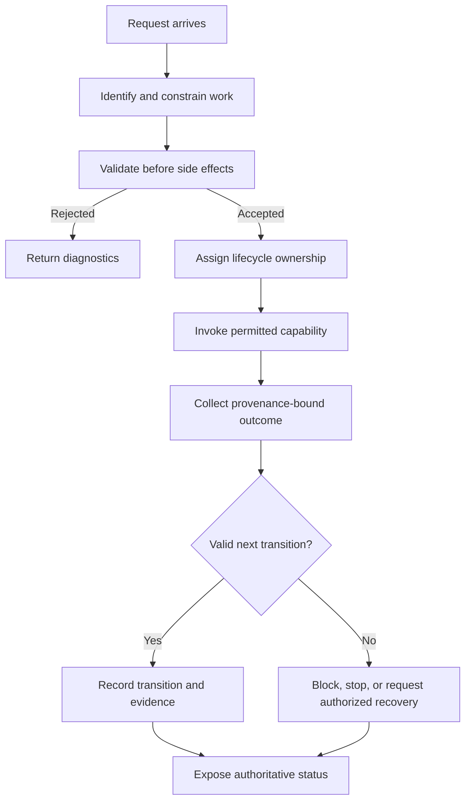

<!-- The Singularity Workshop moniker -->

# 01 — Work as an Explicitly Coordinated Process

**Chapter type:** domain theory and implementation orientation  
**Evidence scope:** Foundry `development`; source references below describe the inspected development implementation unless marked otherwise.

## 01 — What: make work explicit

Imagine asking a workshop to build a cabinet. The request is not the build itself. Someone must understand the request, decide whether it is complete, assign responsibility, obtain the tools and materials, perform the steps, handle defects, and report what was actually delivered.

Software systems face the same distinction. A button click, CI event, issue, or model response may *request* work, but none of those things alone defines a trustworthy execution.

Foundry exists to give work an explicit, inspectable lifecycle. A request becomes a definition or task with identity and constraints. Foundry validates it, coordinates the permitted work, records outcomes, and exposes status to a host. The host supplies environmental capabilities and remains responsible for external credentials and approvals.

The central idea is:

> **A request describes intended work; Foundry coordinates its lifecycle; a host supplies narrowly granted capabilities; evidence explains what happened.**

Foundry is therefore not merely a sequence runner. It is also not an unrestricted agent, shell, CI provider, job queue, or user interface. It is the domain boundary that makes work explicit and governable.

## 02 — Why: separate intent from execution

When intent and execution are mixed together, several failure modes become difficult to detect:

- A request can be malformed but still trigger a partial side effect.
- A user interface can accidentally become the owner of business state.
- A stale worker can continue after its assignment has expired.
- A model can describe a plausible action that the host never authorized.
- A CI summary can be mistaken for evidence about a different commit or run.
- A process can restart and lose the history needed to explain what happened.
- A successful technical operation can be mistaken for permission to publish or deploy.

Explicit coordination creates boundaries where these errors can be rejected, observed, and tested.

### A useful analogy—and where it stops

Think of Foundry as a production coordinator. It can accept a job, check its instructions, assign a worker, track the job's state, collect inspection results, and decide which lifecycle transition is valid.

The analogy stops at physical authority and transactional guarantees. Foundry does not automatically own the worker's machine, the tools, the repository credentials, or the CI provider. A journal write is not a distributed transaction with GitHub. A lease does not forcibly stop a process that ignores cancellation. A recorded approval does not mean Foundry authenticated the human; the host must establish that identity.

## 03 — How: distinguish the domain objects

The first step in reasoning about Foundry is to avoid collapsing different kinds of work into one generic “job”.

| Concept | Question it answers | Foundry responsibility |
|---|---|---|
| Workflow definition | What ordered operations are declared? | Validate the definition and its handler references |
| Workflow run | What happened when this definition was started? | Coordinate the run lifecycle and report structured outcomes |
| Work task | Who is responsible for a bounded unit of repository work? | Track task identity, state, claims, leases, and attempt history |
| Lease | Which worker currently holds a time-bounded assignment? | Validate expiry and fencing identity on lifecycle operations |
| Capability | Which external action may a host permit? | Bind allowed operations to explicit host-granted scope |
| Evidence | What source-backed observation supports an outcome? | Validate provenance and use accepted evidence in bounded decisions |
| Adapter | How does a host or external system participate? | Define a narrow boundary without importing host ownership into the core |

These objects interact, but they are not synonyms. A workflow can be executed as part of a larger task; a task can own multiple attempts; a lease identifies a current claim; and a capability authorizes a particular operation. A CI verdict can inform a repair decision, but it does not itself grant the capability to edit a repository.

### The coordination cycle

This is a **conceptual domain flow**, not a claim that every path is already wired into one production service. The implemented workflow runner, work-task lifecycle, journals, and integration seams are separate components whose exact composition is still being advanced.

### Implementation mapping on development

The current source provides several concrete pieces:

- `WorkflowDefinition`, `WorkflowValidator`, `WorkflowRunner`, and `WorkflowHandlerRegistry` define and execute the sequential workflow slice.
- `WorkflowExecutionCoordinator` retains accepted/running/terminal workflow state around the existing runner. It does not replace the runner.
- `WorkTaskCoordinator` validates task lifecycle transitions, claims, leases, fencing tokens, and audit sequence.
- `PersistentWorkTaskCoordinator` and `JsonlWorkTaskStore` persist and restore task snapshots through a local append-only journal.
- `WorkTaskCapabilityRegistry` represents host-issued scoped capabilities.
- `PersistentCodeRedRecoveryCoordinator` and the CODE RED incident contracts define a guarded recovery path.

The implementation references are intentionally separated: [workflow semantics](../WORKFLOW_SEMANTICS.md), [work-task lifecycle](../WORK_TASK_LIFECYCLE.md), [workflow execution context](../WORKFLOW_EXECUTION_CONTEXT.md), and [architecture](../ARCHITECTURE.md).

### Worked example: an explicit sequential workflow

A host registers two named handlers: `inspect` and `summarize`. It submits a definition whose steps reference those handler keys. Foundry validates the complete definition—including every handler reference—before invoking either handler. The host starts the accepted run once. The runner invokes `inspect`, then `summarize`, and returns structured step and workflow outcomes.

If `inspect` fails, `summarize` is skipped. Foundry does not pretend that side effects already performed by `inspect` were rolled back. If the caller cancels, cancellation is distinct from failure and is cooperative: a handler that ignores its cancellation token can delay completion.

This example describes the supported sequential workflow semantics, not distributed scheduling or automatic retries. See [Workflow Semantics — Version 1](../WORKFLOW_SEMANTICS.md) for the normative details.

## 04 — See it in a minute: follow the real contract

Start with these files:

1. [WorkflowDefinition.cs](../../src/Foundry.Workflow/WorkflowDefinition.cs) — the declared workflow shape.
2. [WorkflowValidator.cs](../../src/Foundry.Workflow/WorkflowValidator.cs) — preflight validation.
3. [WorkflowRunner.cs](../../src/Foundry.Workflow/WorkflowRunner.cs) — ordered execution and structured results.
4. [WorkflowExecutionCoordinator.cs](../../src/Foundry.Workflow/WorkflowExecutionCoordinator.cs) — retained run lifecycle.
5. [WorkTaskCoordinator.cs](../../src/Foundry.Workflow/WorkTaskCoordinator.cs) — task lifecycle and lease transitions.
6. [Workflow tests](../../tests/Foundry.Workflow.Tests/WorkflowRunnerTests.cs) and [coordinator tests](../../tests/Foundry.Workflow.Tests/WorkflowExecutionCoordinatorTests.cs) — executable contract evidence.

The test suite is the practical starting point for reproducing behavior. The source and test links above are navigational references; this chapter does not claim that every CODE RED or external-provider integration has been live-tested.

## 05 — Evidence, limits, and practice

### What the model guarantees—and what it does not

The implemented sequential workflow path validates before invoking handlers, uses host-registered handler keys, preserves declared order, and returns structured outcomes. The task lifecycle validates legal transitions and lease identity. The local task journal provides restart replay on the same host when its persisted data remains valid.

These are bounded guarantees. They do not establish distributed consensus, cross-host lease exclusion, exactly-once external side effects, universal rollback, automatic credential management, or a live end-to-end CI-to-agent-to-GitHub loop. Those require additional contracts, host integrations, threat analysis, and tests.

### Questions for the reader

1. Why is a workflow definition not itself permission to access a filesystem or repository?
2. What is the difference between a workflow run and a work task?
3. Why does a lease need a fencing identity in addition to an expiry time?
4. If a handler performs a side effect and then fails, what can Foundry honestly report?
5. Which guarantees would change if the task store moved from a local journal to a distributed database?

### Exercise

Trace one work task from submission through claim, implementation, validation, and a repair-required outcome. For each transition, identify:

- the actor requesting it;
- the preconditions checked by Foundry;
- the lease or evidence identity involved;
- the durable record written before the operation returns;
- the failure mode if persistence or authority validation fails.

Then compare that task lifecycle with the workflow-run lifecycle. Identify the shared concerns and the distinct invariants; do not merge the two abstractions merely because both have status values.

### Further reading

- [Foundry domain and ownership](../DOMAIN.md)
- [Workflow semantics](../WORKFLOW_SEMANTICS.md)
- [Governed work-task lifecycle](../WORK_TASK_LIFECYCLE.md)
- [UML inventory and policy](../UML/README.md)
- [Foundry roadmap and readiness](../ROADMAP.md)
- [Workshop documentation standard](https://github.com/TrentBest/TheSingularityWorkshop.FSM_COS/blob/development/DOCUMENTATION_STANDARD.md)

---

<!-- THE SINGULARITY WORKSHOP FOOTER -->

