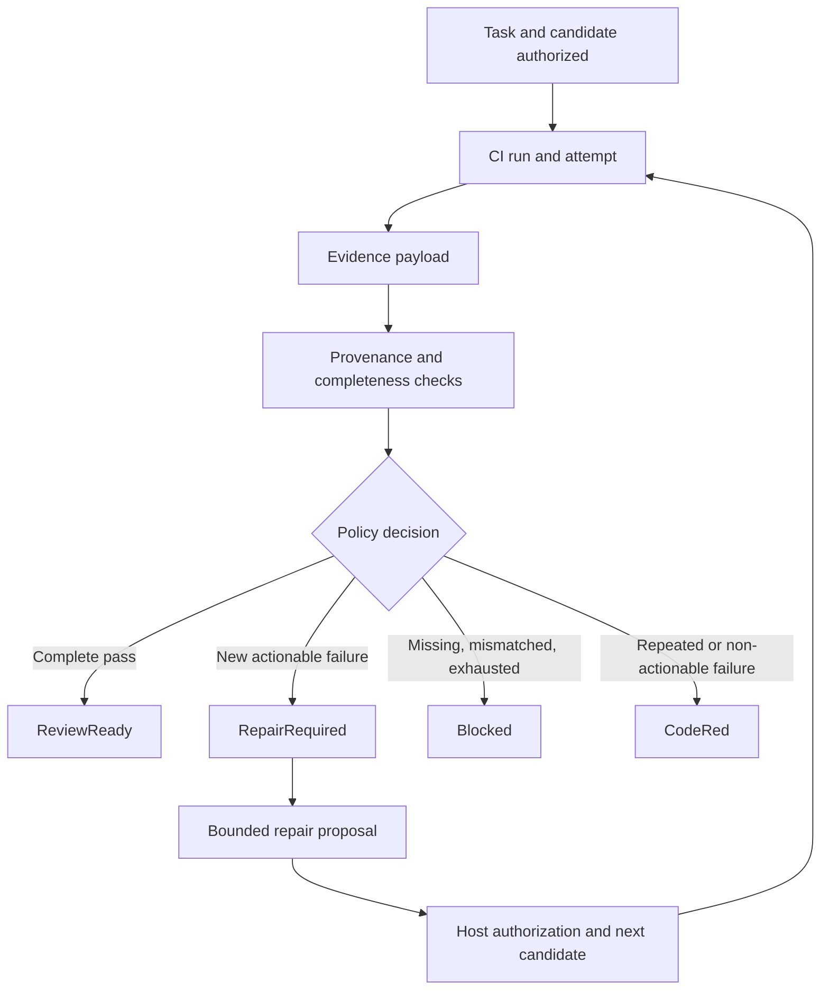

<!-- The Singularity Workshop moniker -->

# 05 — Evidence, Verdicts, and Repair Decisions

**Chapter type:** evidence theory and implementation orientation  
**Evidence scope:** Foundry `development` repair-attempt journal, deterministic decision policy, persistent task coordinator, and lifecycle contract. CiAi callback ingress and report-consumer proposals on draft PR branches are identified separately.

## 01 — An outcome is only as trustworthy as its evidence

A process exit code, a green badge, a model statement, and a CI report are not interchangeable forms of proof.

A useful result answers at least four questions:

1. **What was tested?** Identify the repository, workflow, branch, and exact candidate commit.
2. **Which execution produced it?** Identify the CI run and its attempt, not merely a workflow name.
3. **What evidence was observed?** Preserve the content digest and whether the evidence is complete.
4. **What decision may follow?** Apply a deterministic policy to the evidence and the task's remaining budget.

Foundry's repair policy treats evidence as input to a constrained decision. It does not let a caller assert that a candidate passed by requesting a `ReviewReady` transition.

## 02 — Provenance before interpretation

A repair attempt is a compact audit projection of one CI execution. Its schema-versioned record binds:

- task and correlation identity;
- owner/repository identity;
- isolated feature branch and workflow path;
- task start time and attempt number;
- exact 40-character candidate SHA;
- CI run ID and run-attempt number;
- SHA-256 digest of the evidence payload;
- evidence completeness and success flags;
- actionable-diagnostic presence and optional diagnostic fingerprint;
- start and observation timestamps.

The record is not the full CiAi evidence packet, and its digest does not independently prove who produced the packet. Authentication and trustworthy artifact retrieval are separate integration responsibilities. The projection provides Foundry with a bounded, comparable identity for evaluating a result.

The expected-evidence contract repeats the task, correlation, repository, branch, workflow, candidate SHA, and task-start identity. It may also bind an expected CI run ID and attempt. A mismatch produces a blocked decision rather than allowing evidence from another candidate or run to influence this task.

## 03 — The append-only attempt journal

`JsonlWorkTaskRepairAttemptJournal` preserves attempt records in order. It provides several important properties:

- an identical redelivery of the same attempt is recognized as a duplicate;
- conflicting reuse of an attempt number is rejected;
- gaps and out-of-order attempts are rejected;
- a CI run/attempt pair cannot be reused for another record in the repository;
- a successful attempt prevents later attempts for that task;
- replay validates every record and rejects a torn final record rather than silently discarding evidence.

The journal exposes an immutable attempt-history snapshot and can execute a decision callback while holding its in-process lock. The persistent task coordinator uses this to keep another append from changing the evidence history between validation and the task decision.

This is local append-only persistence, not a distributed evidence ledger. The attempt journal and task snapshot journal are separate files. A crash between their writes can leave an orphan attempt record requiring reconciliation; the files are not one atomic transaction.

## 04 — Deterministic outcomes and bounded repair

`WorkTaskRepairDecisionPolicy.Evaluate` evaluates prior attempts, the current attempt, an expected-provenance tuple, a maximum attempt count, a maximum duration, and the current time.

The supported dispositions are deliberately small:

| Disposition | Meaning |
|---|---|
| `ReviewReady` | Complete evidence proves the exact candidate passed; it may proceed to human review |
| `RepairRequired` | A new actionable failure remains within the configured attempt and time budgets |
| `Blocked` | Evidence is incomplete, mismatched, out of order, or the budget is exhausted |
| `CodeRed` | Failure is not safely actionable, or the candidate/diagnostics show a repeated loop |

The policy checks the task and candidate identity, contiguous attempt numbering, stale or reused run attempts, and configured budgets before interpreting the result. Incomplete evidence never authorizes repair or handoff. A successful exact candidate can become review-ready only when the evidence is complete and internally consistent.

A failed attempt can request another repair only when diagnostics are actionable, the candidate changed from the previous failed attempt, the diagnostic fingerprint is new, and budget remains. A failure without actionable diagnostics, an unchanged candidate, or repeated diagnostics stops the loop and raises CODE RED. Exhausting the final permitted attempt blocks further repair.

The policy does not dispatch CI, invoke an agent, or modify a repository. It returns a deterministic disposition and reason. A coordinator applies that disposition to the task lifecycle and persists the resulting state.

## 05 — The evidence-to-action chain

The final three boxes are a conceptual end-to-end picture. The current development policy evaluates local attempt records; it does not itself connect CI dispatch, model invocation, repository mutation, or draft-PR handoff into one live cycle.

## 06 — Implementation and evidence

1. [WorkTaskRepairAttemptJournal.cs](../../src/Foundry.Workflow/WorkTaskRepairAttemptJournal.cs) — attempt schema, validation, append outcomes, durable JSONL writes, and replay.
2. [WorkTaskRepairDecisionPolicy.cs](../../src/Foundry.Workflow/WorkTaskRepairDecisionPolicy.cs) — exact-provenance checks and deterministic bounded dispositions.
3. [WorkTaskCoordinator.cs](../../src/Foundry.Workflow/WorkTaskCoordinator.cs) — lifecycle evaluation and transition rules.
4. [PersistentWorkTaskCoordinator.cs](../../src/Foundry.Workflow/PersistentWorkTaskCoordinator.cs) — durable task mutation and journal-coordinated evidence decisions.
5. [Work task lifecycle contract](../WORK_TASK_LIFECYCLE.md) — current guarantees and limitations.
6. [Repair policy tests](../../tests/Foundry.Workflow.Tests/WorkTaskRepairDecisionPolicyTests.cs) and [attempt journal tests](../../tests/Foundry.Workflow.Tests/JsonlWorkTaskRepairAttemptJournalTests.cs) — executable behavior evidence.

### Integration status: distinguish the layers

- **Implemented on development:** local repair-attempt records, append-only journal/replay, deterministic bounded policy, and persistent task application bound to the latest durable attempt.
- **Draft PR #14:** CiAi artifact-ready notice validation, durable notice receipt, bounded immutable artifact retrieval, and content verification contracts. It is not merged and does not provide a production callback endpoint or authentication deployment.
- **Draft PR #15:** provenance-bound `ciai.test-results.v1` report consumption and a provider-neutral Foundry report artifact seam. It is not merged and does not by itself prove a live CiAi callback.
- **Draft PR #16:** DNS-pinned HTTPS transport foundation. It is not merged and is not yet the concrete PR #14 transport adapter.

A report schema being documented or a branch passing CI does not mean the remote provider is connected. A future integration must authenticate the sender, bind the notice to persisted dispatch intent, retrieve the immutable artifact through a hardened transport, verify its digest and size, validate report semantics, and only then apply the exact report to the task.

## 07 — What evidence does not authorize

Even a complete successful CI result does not authorize a merge, release, deployment, or package publication. It establishes only that the identified checks reported success for the exact candidate under their configured environment.

Likewise:

- a green workflow badge does not prove all required workflows ran;
- a run ID without an attempt number may be ambiguous after reruns;
- a digest proves byte identity, not source authenticity;
- a model's interpretation of diagnostics is a proposal, not a verdict;
- a successful local unit test does not prove remote callback authentication or artifact transport;
- a `ReviewReady` task state means ready for review, not approved for merge.

Human review and host authorization remain separate gates.

## Questions for the reader

1. Why must evidence bind to the candidate SHA rather than only the branch name?
2. Why are CI run ID and run-attempt number both part of the identity?
3. What does a SHA-256 digest establish, and what does it not establish?
4. Why does incomplete evidence produce `Blocked` rather than `RepairRequired`?
5. Why should an unchanged candidate or repeated diagnostic fingerprint stop an automated loop?
6. Why does `ReviewReady` not mean “merge approved”?

## Exercise

A task expects repository `owner/project`, branch `work/issue-42`, workflow `.github/workflows/ci.yml`, and candidate SHA `0123456789abcdef0123456789abcdef01234567`.

Evaluate four hypothetical observations:

1. The exact candidate passed with complete evidence.
2. The same candidate failed with actionable diagnostics.
3. A different candidate SHA passed, but the report otherwise matches.
4. A later candidate failed with the same diagnostic fingerprint as the previous attempt.

For each, identify the expected disposition and explain which provenance, completeness, loop-detection, or budget rule applies. Then explain why none of the four outcomes independently authorizes merging the branch.

## Further reading

- [Governed work task lifecycle](../WORK_TASK_LIFECYCLE.md)
- [CiAi artifact callback contract](../CIAI_ARTIFACT_CALLBACK_CONTRACT.md)
- [Chapter 03 — Tasks, leases, and lifecycle ownership](03-tasks-leases-and-lifecycle.md)
- [Chapter 04 — Capabilities, authority, and human approval](04-capabilities-and-authority.md)
- [Foundry theory learning path](README.md)

---

<!-- THE SINGULARITY WORKSHOP FOOTER -->

