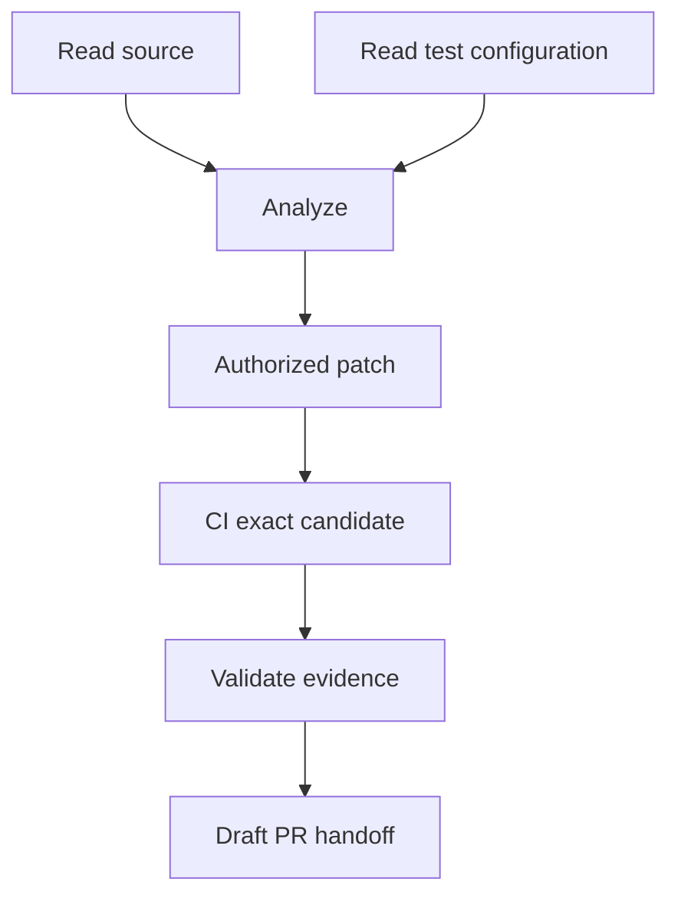

<!-- The Singularity Workshop moniker -->
<p align="center"><a href="https://github.com/TrentBest"></a></p>

# 08 — Scheduling, Dependencies, and Concurrency

**Chapter type:** execution semantics and future scheduling design  
**Evidence scope:** Foundry `development` sequential workflow runner, retained in-process run coordinator, and single-process task lease coordinator. A general dependency-graph scheduler is not implemented.

## 01 — Concurrency is a semantic decision

Running two operations at the same time is not merely a performance setting. It changes the possible order of observations and side effects.

Two independent source inspections may be safe to overlap. A build that consumes files while another operation rewrites those files may not be. A CI result must refer to the exact candidate that was tested. A recovery action must not race with an active incident update. A second agent must not advance a task using a lease that has already been superseded.

A scheduler therefore needs more than a list of tasks. It needs a model of dependency, shared resources, ownership, ordering, cancellation, and evidence.

## 02 — The implemented workflow model: sequential steps

Version 1 represents a workflow as an ordered list of named handler steps. The host registers each handler in `WorkflowHandlerRegistry`; the definition names the handler key but does not embed executable code.

Before invoking any handler, the runner validates the complete definition, including registration of every referenced handler. If validation fails, the run is invalid and no handler executes.

For a valid workflow, `WorkflowRunner` visits steps in declared order. A successful handler allows the next step to run. A failed or cancelled step prevents later handlers from running; remaining steps are recorded as skipped. Foundry does not roll back side effects from earlier handlers.

This gives a clear ordering guarantee within one run. It does not infer dependencies, retry failed steps, compensate prior operations, or run steps in parallel.

## 03 — Multiple runs are not a dependency scheduler

The retained `WorkflowExecutionCoordinator` stores accepted run state and starts a run once. Each started run executes through the same sequential runner. The coordinator can retain multiple run objects, but that is not a general scheduler: it does not construct a dependency graph, allocate bounded worker pools, enforce global resource quotas, or coordinate run ordering across processes.

Likewise, a work-task lease protects ownership within the current `WorkTaskCoordinator` instance. It is not a distributed lock. The HeadlessAi turn journal has a more specific local-filesystem lock protocol, but that does not provide a general-purpose scheduler for workflows or tasks.

## 04 — Dependencies need explicit meaning

A future dependency model should distinguish at least:

- **Data dependency:** one step needs a value produced by another step.
- **Ordering dependency:** one operation must complete before another begins.
- **Resource exclusion:** two operations must not mutate or consume the same protected resource concurrently.
- **Evidence dependency:** an action is permitted only after a specific result has been validated.
- **Lifecycle dependency:** a task or incident must be in a permitted state before work proceeds.
- **Human gate:** execution must wait for an authenticated decision from the host.

These relations are not interchangeable. A data dependency may be satisfied by an immutable artifact, while a resource exclusion may require a lock for the duration of an operation. A human gate is not a normal task handler that can be satisfied by a model-generated string.

A dependency graph also needs explicit handling for missing nodes, cycles, failed prerequisites, skipped descendants, and changes to the graph after execution begins.

## 05 — A safe path toward parallel work

A future scheduler should begin with conservative rules:

1. Preserve the current sequential behavior as the default and compatibility baseline.
2. Require explicit dependency declarations rather than guessing from handler names or output keys.
3. Permit parallel execution only for nodes whose dependencies are satisfied and whose declared resource claims do not conflict.
4. Keep side-effecting operations serialized when their ordering or idempotency is not proven.
5. Bind every result to the exact task, candidate, and prerequisite evidence that produced it.
6. Propagate cancellation to active work and record work that could not be stopped.
7. Treat an interrupted side effect as indeterminate until reconciled; do not assume cancellation rolled it back.
8. Make concurrency limits and fairness policy host-configurable and observable.

Parallel execution must not weaken capability checks, lease fencing, evidence provenance, or human approval boundaries.

## 06 — Worked example: source inspection and validation

Consider a future task with these operations:

```text
A: Read source files
B: Read test configuration
C: Analyze the source and configuration
D: Apply an authorized patch
E: Run CI for the exact candidate SHA
F: Evaluate the complete CI evidence
G: Prepare a draft-PR handoff
```

A and B might be independent reads if both are within the granted path scope. C depends on both results. D depends on C and a host-issued write capability. E depends on D and the exact candidate commit. F depends on complete evidence for that exact candidate. G depends on a successful decision and remains a draft handoff; it does not authorize merge.

The diagram is a conceptual dependency graph, not a description of a scheduler currently present in Foundry.



Even this small example needs resource and authority rules. A and B may be parallel reads. D must not race with another writer. E must not start until the exact candidate exists. F cannot treat a missing report as success. G must not bypass the host's review policy.

## 07 — Implementation map and current limits

1. [WorkflowRunner.cs](../../src/Foundry.Workflow/WorkflowRunner.cs) — sequential step execution and failure/cancellation behavior.
2. [WorkflowExecutionCoordinator.cs](../../src/Foundry.Workflow/WorkflowExecutionCoordinator.cs) — retained in-process run lifecycle and per-run start control.
3. [Workflow semantics](../WORKFLOW_SEMANTICS.md) — validation, ordering, context, outcomes, and explicit non-goals.
4. [WorkTaskCoordinator.cs](../../src/Foundry.Workflow/WorkTaskCoordinator.cs) — task claims, leases, fencing, and validated transitions.
5. [PersistentWorkTaskCoordinator.cs](../../src/Foundry.Workflow/PersistentWorkTaskCoordinator.cs) — single-process serialized task mutation and persistence.

The following are not implemented as general Foundry capabilities: dependency-graph scheduling, parallel steps within a workflow, bounded worker pools, distributed queues, global resource locks, retry orchestration, compensation, durable workflow-run recovery, or multi-host lease arbitration. A feature-branch timeout extension does not change those boundaries.

## Questions for the reader

1. Why is declared step order a stronger contract than an inferred execution order?
2. What is the difference between a data dependency and a resource exclusion?
3. Why can two independent workflow runs coexist without Foundry being a general scheduler?
4. Which operations in the worked example could overlap safely, and what assumptions make them safe?
5. Why does cancellation not imply rollback?
6. Which provenance and authority guarantees must remain unchanged if parallel execution is introduced?

## Exercise

Take the seven-operation example above. Add a second test run that may execute while the first task is being repaired.

Identify:
- which reads may overlap;
- which writes require exclusive access;
- which evidence must bind to an exact candidate SHA;
- which operations must wait for human or host authorization;
- how a failed prerequisite affects dependent nodes;
- what the scheduler should record if an external operation times out after it may have taken effect.

Then design one dependency cycle and explain how validation should reject it before execution.

## Further reading

- [Workflow semantics](../WORKFLOW_SEMANTICS.md)
- [Chapter 02 — Workflow definitions and execution semantics](02-workflow-definitions-and-execution.md)
- [Chapter 04 — Capabilities, authority, and human approval](04-capabilities-and-authority.md)
- [Chapter 07 — Hosts, adapters, and external systems](07-hosts-and-adapters.md)
- [Foundry theory learning path](README.md)

---

<!-- THE SINGULARITY WORKSHOP FOOTER -->
<p align="center"></p>
