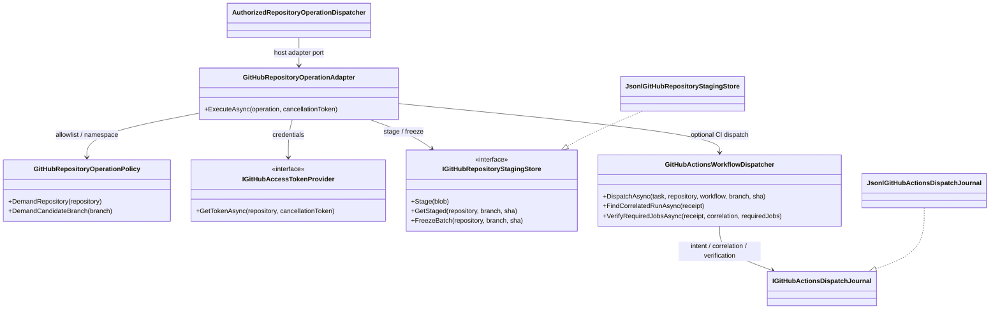
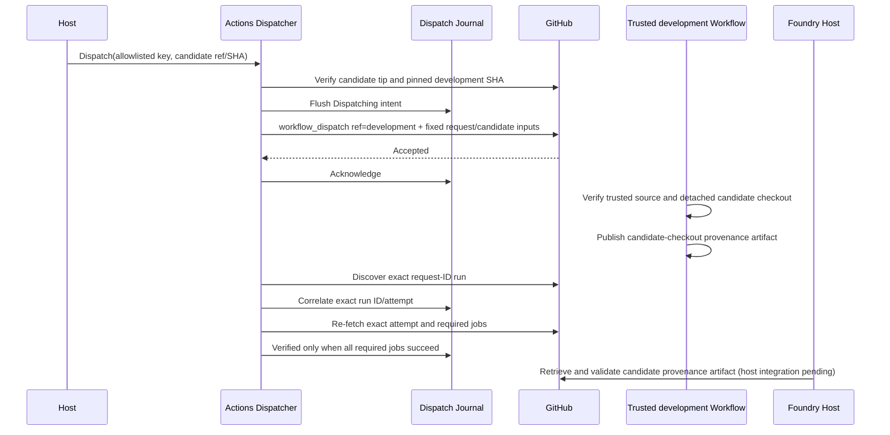

# GitHub Host Adapter UML

## Component neighborhood



## Candidate commit sequence

```mermaid
sequenceDiagram
    participant Dispatcher as Foundry Dispatcher
    participant Adapter as GitHub Repository Adapter
    participant Policy as Host Policy
    participant Tokens as Token Provider
    participant Stage as Staging Store
    participant GitHub

    Dispatcher->>Adapter: Execute(typed operation)
    Adapter->>Policy: Demand repository and agents branch
    Adapter->>Tokens: Get short-lived host token
    alt create branch
        Adapter->>GitHub: Read exact base commit; refuse existing branch
        Adapter->>GitHub: Create ref at exact base SHA
    else read file
        Adapter->>GitHub: Verify candidate tip and read path at immutable SHA
    else write file
        Adapter->>GitHub: Create blob
        Adapter->>Stage: Record blob SHA + content digest
    else create commit
        Adapter->>Stage: Freeze exact candidate batch
        Adapter->>GitHub: Create tree and single-parent commit
        Adapter->>GitHub: Non-force ref update
        Adapter->>GitHub: Re-read and verify ref/tree/parent/message
    end
    Adapter-->>Dispatcher: Validated operation reference and candidate SHA
```

## CI dispatch and evidence sequence



## Boundaries

The workflow run's branch/SHA describe trusted `development` workflow source; the candidate checkout has separate provenance. Dispatch acceptance is not CI evidence. Fake HTTP tests are not live GitHub proof. JSONL staging and dispatch journals are local-host persistence, not distributed coordination. The host still needs to retrieve and validate the candidate provenance artifact and ingest verified evidence into the Foundry task lifecycle.
