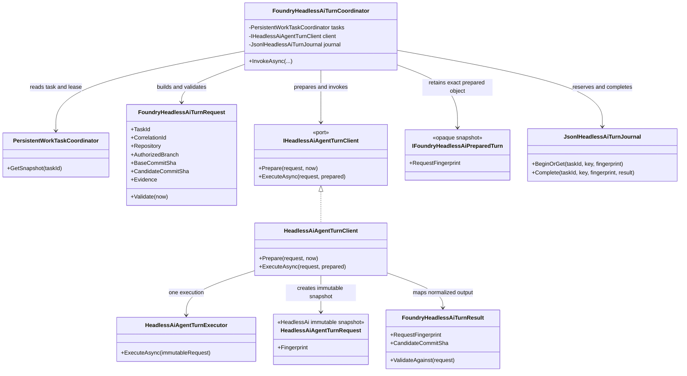

<!-- The Singularity Workshop moniker -->
<p align="center"><a href="https://github.com/TrentBest"></a></p>

# HeadlessAi Turn Bridge UML

**Evidence level:** source- and test-grounded manual UML for the feature branch. The diagrams describe the in-process bridge and local JSONL journal; they do not claim a live provider invocation.

## 1. Type neighborhood



## 2. One-turn sequence

```mermaid
sequenceDiagram
    participant Host
    participant Coordinator as FoundryHeadlessAiTurnCoordinator
    participant Tasks as PersistentWorkTaskCoordinator
    participant Client as IHeadlessAiAgentTurnClient
    participant Journal as JsonlHeadlessAiTurnJournal
    participant Provider as HeadlessAiAgentTurnExecutor

    Host->>Coordinator: InvokeAsync(task, lease, branch, candidate, prompt)
    Coordinator->>Tasks: GetSnapshot(taskId)
    Tasks-->>Coordinator: task + active lease + status
    Note over Coordinator: Require exact unexpired lease and Investigating state
    Coordinator->>Coordinator: Build request + deterministic idempotency key
    Coordinator->>Coordinator: Validate branch, SHAs, issue, expiry, evidence bounds
    Coordinator->>Client: Prepare(request, now)
    Client-->>Coordinator: immutable prepared snapshot + canonical fingerprint
    Coordinator->>Journal: BeginOrGet(task, key, invocation fingerprint)
    alt exact completed duplicate
        Journal-->>Coordinator: prior normalized result
        Coordinator-->>Host: validated recorded result
    else new invocation
        Journal-->>Coordinator: reserved
        Note over Journal: Pending intent flushed before provider call
        Coordinator->>Client: ExecuteAsync(same request, same prepared snapshot)
        Client->>Provider: ExecuteAsync(immutable snapshot)
        Provider-->>Client: normalized HeadlessAi result
        Client-->>Coordinator: mapped Foundry result
        Coordinator->>Coordinator: Validate provenance + canonical fingerprint + bounds
        Coordinator->>Journal: Complete(task, key, fingerprint, result)
        Note over Journal: Validated result durable before post-call lease check
        Coordinator->>Tasks: GetSnapshot(taskId)
        alt lease still current and Investigating
            Tasks-->>Coordinator: current lease
            Coordinator-->>Host: validated result
        else lease expired, replaced, or state changed
            Tasks-->>Coordinator: stale task snapshot
            Coordinator-->>Host: reject caller; result remains journaled for reconciliation
        end
    end
```

## 3. Failure and replay boundaries

```mermaid
sequenceDiagram
    participant Coordinator
    participant Journal
    participant Provider

    Coordinator->>Journal: BeginOrGet(task, idempotency key, fingerprint)
    Journal-->>Coordinator: Pending durably appended
    Coordinator->>Provider: one request
    alt provider result validated and journaled
        Provider-->>Coordinator: result
        Coordinator->>Journal: Complete(...)
        Journal-->>Coordinator: durable completion
        Note over Coordinator,Journal: Exact duplicate returns recorded result without another provider call
    else cancellation, transport failure, or process loss after reservation
        Provider--xCoordinator: outcome may be unknown
        Note over Journal: Pending remains without a result
        Coordinator->>Journal: later BeginOrGet with same identity
        Journal-->>Coordinator: indeterminate; reject automatic replay
    end
```

## 4. Invariants and limits

- The coordinator accepts only a current, unexpired task lease while the task is in Investigating.
- Candidate work must use an isolated Git-valid branch; master and development are rejected. Base and candidate identities are full commit SHAs.
- Supplied CI evidence is bounded and must identify the same repository and current or explicitly prior candidate SHA. Evidence remains untrusted context.
- The idempotency key is derived from task identity, branch/candidate provenance, prompt/schema/instructions, prior-turn identity, and evidence. Reusing a key with different canonical invocation data is rejected.
- Prepare is local and side-effect-free. ExecuteAsync must use the exact prepared immutable HeadlessAi request; the adapter rejects a different request instance.
- A result is checked against task, correlation, repository, branch, base/candidate SHA, prior-turn identity, idempotency key, bounds, and the prepared request fingerprint.
- A durable Pending reservation precedes the provider call. A post-reservation interruption is indeterminate and is not automatically retried. Exact completed duplicates replay the stored normalized result.
- A validated result is persisted before the coordinator rechecks the lease. If the lease became stale during the provider call, the caller is rejected while the result remains available for reconciliation.
- The JSONL journal uses a local filesystem lock protocol. It is not a distributed ledger and does not establish cross-host coordination.
- Model proposals do not grant capabilities, mutate task state, or perform repository operations. The bridge performs no GitHub access, writes, CI dispatch, PR creation, retries, merge, release, or deployment.

## 5. Test traceability

- HeadlessAiTurnBridgeTests covers lease/state gates, request validation, canonical idempotency, duplicate suppression, indeterminate outcomes, pre-cancel behavior, fingerprint mismatch, and lease expiry during invocation.
- HeadlessAiAgentTurnClientTests covers immutable snapshot execution, normalized mapping, provider credential separation from request body, and rejection of a prepared snapshot paired with a different request instance.
- These are deterministic/fake-transport tests. They do not establish that a production provider credential was provisioned or that a live model turn succeeded.
- Source companions: [turn bridge contract](../HEADLESSAI_TURN_BRIDGE.md) and [host adapter](../HEADLESSAI_HOST_ADAPTER.md).

<!-- THE SINGULARITY WORKSHOP FOOTER -->
<p align="center"></p>
