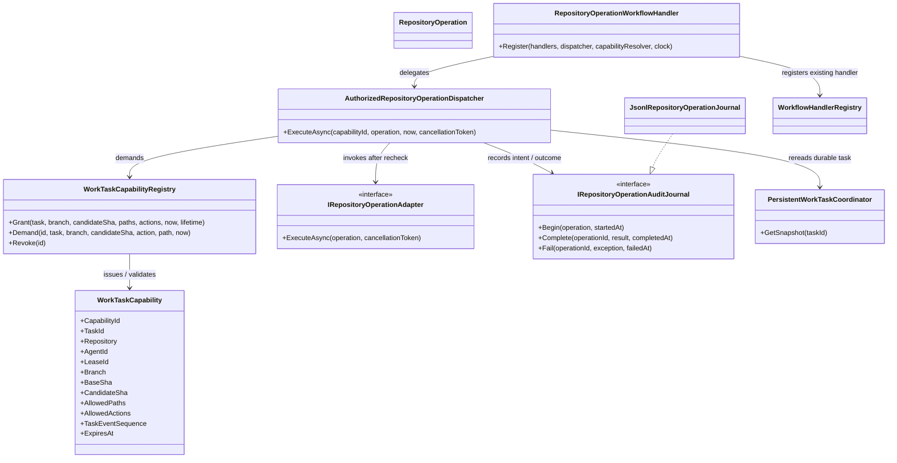

# Repository Operation Authorization UML

This view documents the boundary between host-issued task capabilities, durable task state, operation audit, and the repository transport adapter.

## Class neighborhood



## Authorization and transport sequence

```mermaid
sequenceDiagram
    participant Host
    participant Handler as WorkflowOperationHandler
    participant Dispatcher
    participant Tasks as PersistentTaskCoordinator
    participant Registry as CapabilityRegistry
    participant Journal as OperationAuditJournal
    participant Adapter as HostRepositoryAdapter

    Host->>Registry: Grant from active task snapshot
    Host->>Handler: Register host capability resolver
    Handler->>Dispatcher: Execute(capabilityId, typed operation)
    Dispatcher->>Tasks: GetSnapshot(taskId)
    Dispatcher->>Registry: Demand(exact task, lease, branch, SHA, action, path)
    Dispatcher->>Journal: Begin(Pending intent; flush)
    Dispatcher->>Tasks: GetSnapshot(taskId) again
    Dispatcher->>Registry: Demand again using current clock
    alt task/capability invalidated
        Dispatcher->>Journal: Fail(intent)
        Dispatcher-->>Handler: deny; adapter untouched
    else still authorized
        Dispatcher->>Adapter: ExecuteAsync(operation)
        Adapter-->>Dispatcher: operation reference + requested/result SHA
        Dispatcher->>Dispatcher: Validate provenance and SHA movement rule
        alt valid result
            Dispatcher->>Journal: Complete(intent, validated result)
        else invalid result or adapter exception
            Dispatcher->>Journal: Fail(intent, exception type only)
        end
        Dispatcher-->>Handler: result or failure
    end
```

## CODE RED invalidation

A capability records the task event sequence at grant time. If any later task event transitions to CODE RED, that capability is permanently invalidated. Recovery does not revive it. CODE RED grants may be read-only; post-recovery mutation requires a new host-issued capability against the recovered snapshot.

## Audit crash boundary

The journal's Pending record is flushed before adapter invocation. If the process stops after the external side effect but before a terminal audit record, the operation remains indeterminate and requires explicit reconciliation. The JSONL file lock coordinates cooperating local processes only; it is not a distributed transaction or provider-side idempotency guarantee.

## Implementation boundary

The current operation hierarchy implements read-file, write-file, create-branch, create-commit, and request-CI. `CreateDraftPullRequest` exists in the action enum but has no corresponding operation implementation in this path. Tests use deterministic fakes; live provider execution and full CI-evidence-to-draft-PR closure remain separate gates.
