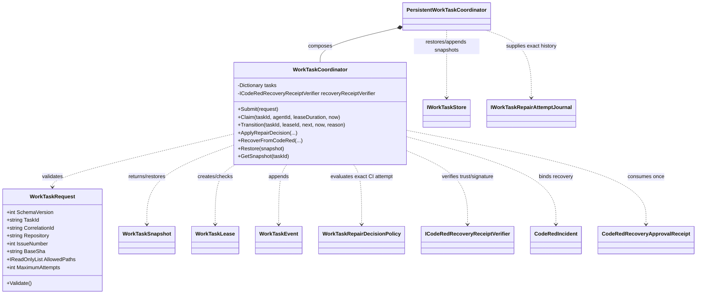

<!-- The Singularity Workshop moniker -->
<p align="center"><a href="https://github.com/TrentBest"></a></p>

# WorkTaskCoordinator UML

**View type:** source-grounded class neighborhood and lifecycle sequence.  
**Source:** `src/Foundry.Workflow/WorkTaskCoordinator.cs`, `PersistentWorkTaskCoordinator.cs`.  
**Scope:** deterministic in-process task state authority; persistence and host trust are shown as separate collaborators.

## Class neighborhood



## Evidence-derived validation sequence

```mermaid
sequenceDiagram
    participant Host
    participant Persistent as PersistentWorkTaskCoordinator
    participant Journal as RepairAttemptJournal
    participant Coordinator as WorkTaskCoordinator
    participant Policy as WorkTaskRepairDecisionPolicy
    Host->>Persistent: ApplyRepairDecision(task, lease, currentAttempt, expectation, ...)
    Persistent->>Journal: ExecuteWithAttempts(taskId, callback)
    Journal->>Persistent: exact durable attempt history
    Persistent->>Persistent: verify currentAttempt is latest journal record
    Persistent->>Coordinator: ApplyRepairDecision(previous, current, expectation, ...)
    Coordinator->>Coordinator: verify lease, task, attempt and expectation identity
    Coordinator->>Policy: Evaluate(history, current, expectation, maxAttempts, maxDuration, now)
    Policy-->>Coordinator: bounded decision + reason
    Coordinator->>Coordinator: validate transition and append event
    Coordinator-->>Persistent: immutable task snapshot
    Persistent->>Persistent: append snapshot; fail closed if persistence fails
    Persistent-->>Host: persisted snapshot
```

## CODE RED recovery sequence

```mermaid
sequenceDiagram
    participant Host as Authenticated host
    participant Coordinator as WorkTaskCoordinator
    participant Verifier as Receipt verifier
    Host->>Coordinator: RecoverFromCodeRed(task, lease, incident, receipt, now, reason)
    Coordinator->>Coordinator: require CodeRed status and active lease
    Coordinator->>Coordinator: bind incident to task, repository, correlation and agent
    Coordinator->>Coordinator: bind receipt to incident/task event sequence and action
    Coordinator->>Verifier: trusted issuer + signature verification
    Verifier-->>Coordinator: trusted / rejected
    Coordinator->>Coordinator: reject consumed receipt; transition to Investigating
    Coordinator-->>Host: snapshot with approval provenance event
```

## Interpretation and limits

- The coordinator's lock serializes operations within one process. It does not establish cross-process or distributed lease exclusivity.
- The persistent wrapper serializes local operations and journals snapshots; a failed append makes that wrapper fail-closed. This is not a distributed transaction.
- The host remains responsible for authenticating the human and issuing a receipt. The verifier only establishes that the receipt's issuer and signature are trusted.
- A CI attempt cannot be converted to `ReviewReady` by setting a status. It must pass the evidence policy with task/run/candidate provenance.
- This view describes implemented types and call paths, not the still-incomplete CODE RED-to-draft-PR product loop.

---

<!-- THE SINGULARITY WORKSHOP FOOTER -->
<p align="center"></p>
