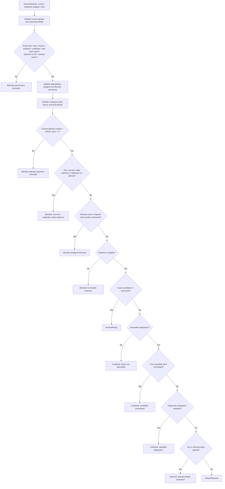

<!-- The Singularity Workshop moniker -->

# WorkTaskRepairDecisionPolicy — Source-Derived Decision Flow

**Scope:** Manual control-flow view of `WorkTaskRepairDecisionPolicy.Evaluate` and its append-only attempt-history input. This is source-derived, not generated UML and not a claim that live CiAi evidence ingestion is complete.

## Ownership and inputs

`WorkTaskRepairDecisionPolicy` is a deterministic decision function. It does not dispatch CI, invoke HeadlessAi, grant capabilities, mutate task state, or append journal records.

- `WorkTaskRepairAttempt` is the compact, validated record of one exact CI run attempt: task/correlation, repository, isolated branch, workflow path, task start, attempt number, candidate SHA, run ID/attempt, evidence-payload digest, completeness/success, actionable-diagnostic fingerprint, and timestamps.
- `WorkTaskRepairEvidenceExpectation` is the host/task-side expected identity. It binds task/correlation, repository, branch, workflow path, candidate SHA, and task start; it can additionally require an exact CI run ID and run-attempt.
- `JsonlWorkTaskRepairAttemptJournal` owns append-only history, duplicate/conflict/out-of-order handling, replay validation, and the lock used to evaluate a stable history snapshot in persistent task-decision composition.

## Decision flow

## Important semantics

1. Provenance is checked before a decision can be derived. A packet for a different task, repository, branch, workflow, candidate SHA, task start, or optionally required run/attempt is blocked.
2. Prior attempts must be contiguous, belong to the same task tuple, and cannot continue after success. The current attempt must be exactly the next ordinal. Reusing the previous run/attempt or arriving before its observation is blocked.
3. The maximum attempt count is constrained to 1–10; maximum duration must be positive and no more than 24 hours. Decision time cannot precede evidence observation.
4. Incomplete evidence is blocked. Complete successful evidence becomes `ReviewReady`.
5. An unsuccessful result with no actionable diagnostics becomes `CodeRed`. Actionable failures also become `CodeRed` if the candidate SHA did not change or the diagnostic fingerprint repeated.
6. Only a new candidate with new actionable diagnostics and remaining attempt/time budget becomes `RepairRequired`. A failed final permitted attempt is blocked; it does not authorize another repair cycle.
7. The policy returns one of `ReviewReady`, `RepairRequired`, `Blocked`, or `CodeRed`, with a stable reason code. The caller remains responsible for durable task-state transition and audit.

## Persistence and atomicity boundary

The JSONL attempt journal validates each record, appends in ordinal order, treats identical same-ordinal redelivery as duplicate, rejects conflicts and run-attempt reuse, and refuses a torn final record during replay. `ExecuteWithAttempts` supplies an immutable history snapshot while holding the journal's in-process lock so a concurrent append cannot alter the history during the composed decision.

The attempt journal and task-snapshot journal are separate files. A crash between their writes can leave an orphan attempt record; this is not a cross-file transaction and must be reconciled. The lock is local to one journal instance/process, not a distributed lock.

## Test traceability

Source: `src/Foundry.Workflow/WorkTaskRepairDecisionPolicy.cs` and `WorkTaskRepairAttemptJournal.cs`.

Deterministic tests: `tests/Foundry.Workflow.Tests/WorkTaskRepairDecisionPolicyTests.cs` and `JsonlWorkTaskRepairAttemptJournalTests.cs`. The policy tests cover actionable repair, successful review readiness, incomplete/non-actionable evidence, unchanged candidate, repeated diagnostics, new candidate/new diagnostics, attempt/time exhaustion, ordering, post-success rejection, exact provenance including optional run/attempt, and invalid budgets/timestamps. Journal tests cover append/replay and duplicate/conflict/order behavior.

These tests establish deterministic local policy and journal behavior. They do not prove a live CiAi callback, GitHub artifact retrieval, remote evidence authenticity, or the complete red-to-draft-PR loop.

---

<!-- The Singularity Workshop footer -->

